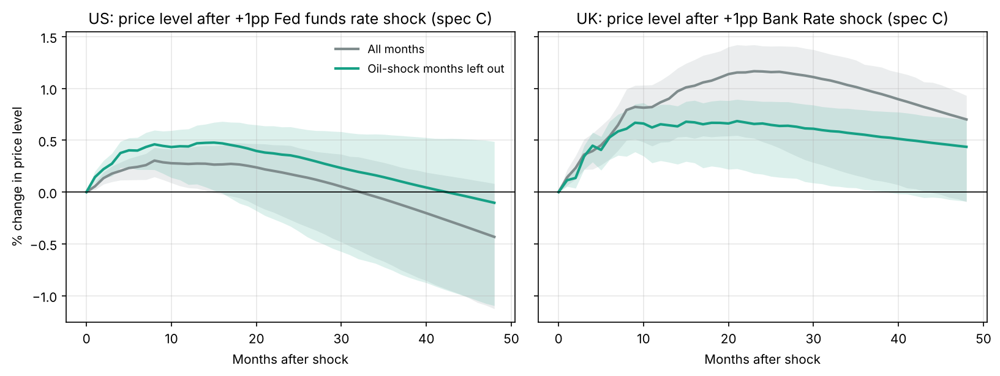
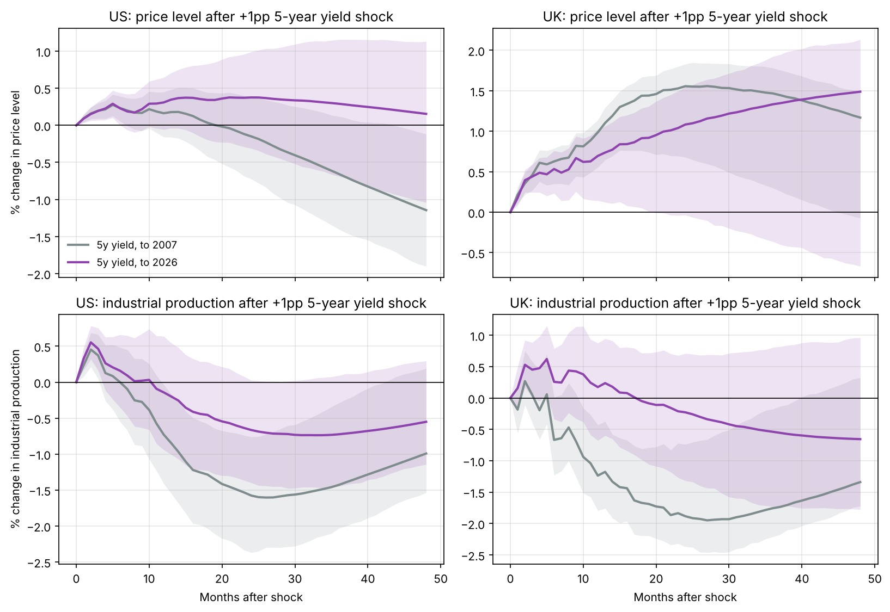

# Testing Economic Theory Against the Data

I'm testing well-known economic claims against real US and UK data to see if the data backs them up. The first claim is the big one: **do higher interest rates lower inflation?**

## What theory says

Raising rates makes borrowing more expensive. People and firms spend and invest less, demand falls, output slows and unemployment rises. With less pressure on prices, inflation comes down, usually 1 to 2 years later.

So after a rate rise I expect **output to fall first, then prices**.

Theory also already accounts for the fact that central banks raise rates *because* inflation is high. That's the central bank's reaction function, like the Taylor rule. So the question isn't whether theory misses this. The question is whether we can measure the effect of rates on inflation when the two are tangled together like that.

## The measurement problem

In the raw data, rates and inflation move **together**:

| Correlation of policy rate with inflation | US 1965–2007 | UK 1975–2007 |
|---|---|---|
| Same month | +0.72 | +0.64 |
| Inflation 12 months later | +0.51 | +0.63 |

That doesn't mean rate rises cause inflation. Most of it is the central bank reacting to inflation. To get the real effect, I need the part of rate changes that wasn't just a predictable reaction.

There are also other things that move both at once. Output and demand conditions are always there. Big oil shocks (1973, 1979, 1990) aren't the normal state of the economy, but they push inflation and rates up together when they happen, so I test them separately.

## What I did

1. **Forecast regressions.** Inflation 12 and 24 months ahead on today's policy rate. First on its own, then controlling for current and past inflation, unemployment, output growth and commodity prices. Newey-West standard errors.
2. **VARs.** A 12-lag monthly model with the policy rate ordered last (the Christiano, Eichenbaum and Evans 1999 approach). The central bank can react to the economy within the month, but its rate surprise only hits the economy from the next month. I add controls one at a time:
   - **A:** prices + rate
   - **B:** + output
   - **C:** + commodity prices

   Results are scaled to a +1 percentage point rate rise, with 90% bootstrap bands (500 draws).
3. **Oil-shock test.** I rerun everything leaving out the three big oil-shock periods (Oct 1973 to Jun 1975, Jan 1979 to Jun 1981, Aug 1990 to Jun 1991) to see how much they drive the results.

4. **Going past 2007.** I swap the policy rate for the 5-year government bond yield and rerun to August 2026 (see below for why).

My main samples stop at 2007. That's on purpose: from 2009 policy rates sat near zero for years (US until 2015, UK until 2021) and central banks used QE instead. A model built on rate changes breaks when rates can't move. But it also means the main results miss the 2022–23 rate rises, so I test the full period separately with bond yields.

## What I found


**1. Controls flip the sign in the US.** With no controls, a 1 point higher Fed funds rate goes with inflation 0.15 points *higher* two years later. Holding the economy constant, it's **0.43 points lower** (s.e. 0.13).

**2. Each control shrinks the wrong-way effect.** In the US model, the rise in prices after a rate hike drops from +0.66% (A) to +0.34% (B) to +0.17% (C) at 24 months. With commodity prices in, prices end up **0.43% lower after four years**, though the band still just includes zero.

**3. Output falls like theory says, in both countries.** A 1 point rate rise cuts industrial production by about **1.3% in the US and 1.5% in the UK** after 2 to 3 years. This is the clearest result.


**4. The UK only fits theory under inflation targeting.** Over 1975–2007, UK prices go up after a rate rise in every version. From October 1992 on, prices fall by about **1.1% after four years** (spec C, band just touching zero with only 15 years of data). The regression with controls gives **−0.30 points** at 24 months (s.e. 0.06).

**5. The US after 1984 still points the wrong way.** This is a known issue with this method (Ramey, 2016). Once a central bank is predictable, very few rate moves are real surprises, so it's hard to isolate them.

### Oil-shock test



**In the US, oil shocks drive a lot of the raw correlation.** Leaving them out cuts the 12-month correlation from +0.51 to +0.25, and the 24-month one from +0.17 to +0.07.

**But they don't explain the wrong-way effect in the model.** Once commodity prices are already controlled for, dropping the shock months doesn't help: the US price response at 24 months is +0.35% without them vs +0.17% with them. The regression with controls is still negative (−0.24 at 24 months, s.e. 0.10).

**In the UK, oil shocks aren't the issue.** The correlation barely changes, or rises. The wrong-way effect gets smaller but doesn't go away.

So the problem isn't mainly the unusual shock periods. It's in normal times too, which points back to the central bank reacting to inflation it expects. The model doesn't see the forecasts the central bank was looking at.

### Going past 2007



Bond yields kept moving when policy rates were stuck at zero, because they react to QE and to what markets expect central banks to do next. The Bank of England database only has monthly gilt yields at 5, 10 and 20 years, so I use the 5-year yield for both countries to keep them comparable, plus the US 2-year as a check. I leave out the COVID months (March 2020 to June 2021), because the output collapse would swamp everything else.

**First, the yield works as a stand-in.** Up to 2007, a +1 point rise in the US 5-year yield lowers prices by **1.1% after four years** (band below zero) and output by **1.6%** after two years. That's actually cleaner than the policy-rate results.

**Adding 2008–2026 makes the effects much weaker.** With the full US sample, the price effect is close to zero (+0.15% at four years, wide band) and the output effect roughly halves (−0.7%, borderline significant). The 2-year yield gives the same picture. In the UK nothing is significant over the full period.

**Why it weakens:**
- From 2009 to 2021, yields moved a lot for reasons other than policy (QE, global demand for safe bonds), so the "rate shock" becomes noisier
- In 2021–22, inflation shot up from supply shocks first and central banks raised rates after. That's the same reverse-causality problem as the 1970s, and this model can't fully separate it

So the recent period doesn't overturn the theory, but this method can't confirm it either. A cleaner measure of policy surprises is needed for the post-2008 world.

## Theory vs what I found

| Prediction | US | UK |
|---|---|---|
| Output falls after a rate rise | Yes, about −1.3% | Yes, about −1.5% |
| Prices fall after a rate rise | Partly: only with controls, weak | Partly: only after 1992 |
| Effect takes 1 to 2+ years | Yes | Yes |
| Oil shocks explain the wrong-way effect | No, only the raw correlation | No |
| Still holds when extended to 2026 | Weaker, mostly not significant | Not significant |

**So far:** rate rises clearly slowed the economy before 2008. The effect on inflation is there, but it's weaker, slower and more dependent on the monetary regime than the textbook makes it sound. After 2008 this method can't pin it down.

### Limitations

- The model assumes rates don't affect prices or output in the same month
- I use US commodity prices (PPI) as the commodity control for both countries
- The UK model doesn't include the exchange rate yet, which matters a lot for the UK
- UK CPI before 1988 comes from OECD data, spliced onto the ONS series
- The main results stop at 2007. The extension to 2026 uses 5-year yields, which also move with things other than policy (QE, term premia, global bond demand)
- The UK 5-year gilt series only starts in 1982

## What I expect next

| Next step | What I expect |
|---|---|
| Add the sterling exchange rate to the UK model | A stronger pound cuts import prices, so this should fix a lot of the pre-1992 UK result |
| Local projections (Jordà, 2005) | Same signs as the VAR, with wider bands |
| Rate surprises from central bank announcement days | Cleaner shocks. Research using these finds prices fall clearly, even after 1984 |
| Add central bank forecasts as controls | Should remove the "reacting to expected inflation" problem the oil test pointed to |
| Shadow rates for 2009–2021 | A closer measure of policy at zero than bond yields; should give clearer post-2008 results |
| Claim 2: does money supply cause inflation? | Theory says yes in the long run. I expect a weak link in low-inflation periods |
| Claim 3: the Phillips curve | Lower unemployment should push inflation up. I expect this link to have flattened since the 1990s |

## Data

US: FRED. UK: ONS (CPI, unemployment, industrial production), Bank of England (Bank Rate), OECD via FRED (CPI before 1988). Details in [`data/README.md`](data/README.md).

## Run it

```bash
pip install -r requirements.txt
python run_analysis.py      # writes results/ (about 2 minutes)
pytest                      # tests, including a check against statsmodels' VAR
```

## Structure

```
run_analysis.py      regressions, VARs, oil-shock test, extension to 2026, charts
src/load_data.py     builds the US and UK monthly panels
src/var.py           VAR, impulse responses, bootstrap
tests/               unit tests
data/raw/            source data as downloaded
results/             summary tables and charts
```
