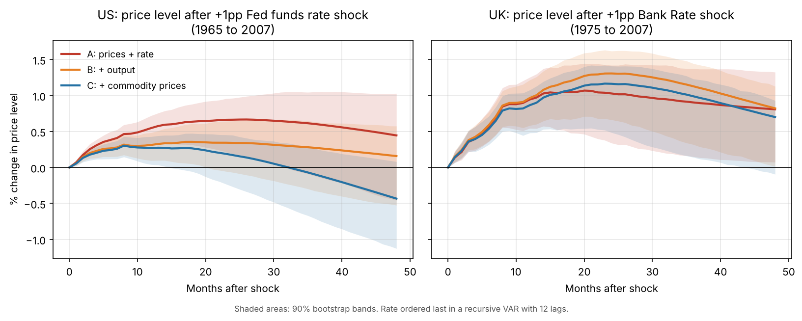
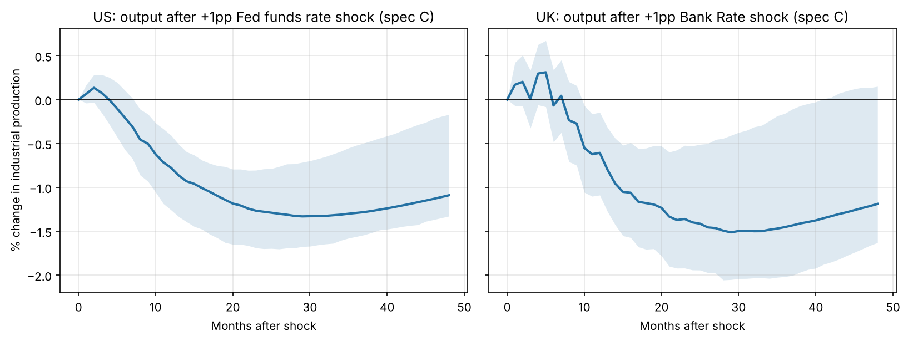

# Testing Economic Theory Against the Data

Economics is full of claims that sound obvious: higher interest rates lower inflation, printing money causes inflation, lower unemployment pushes prices up. This project tests those claims against real US and UK data, and shows how **confounding variables** and **reverse causality** can make the raw data point the wrong way.

**Claim 1 (this release): do higher interest rates lower inflation?**

## What theory expects

The monetary transmission mechanism says a rate rise works like this:

1. Borrowing becomes more expensive, so households and firms spend and invest less
2. Lower demand slows output and raises unemployment
3. With less pressure on prices, inflation falls, typically with a lag of 1 to 2 years

So after a rate rise we expect **output to fall first, then prices to fall**.

## Why the raw data can't answer it

In the raw data, interest rates and inflation move **together**:

| Correlation of policy rate with inflation | US 1965–2007 | UK 1975–2007 |
|---|---|---|
| Same month | +0.72 | +0.64 |
| Inflation 12 months later | +0.51 | +0.63 |

Taken at face value this says rate rises *cause* inflation. Two problems explain it:

- **Reverse causality:** central banks raise rates *because* inflation is high
- **Confounders:** oil and commodity price shocks push inflation up and prompt rate rises at the same time

The project tests how much of the positive link disappears once these are accounted for.

## Method

1. **Forecast regressions.** Inflation 12 and 24 months ahead on today's policy rate, first alone, then controlling for current and lagged inflation, unemployment, output growth and commodity price growth (Newey-West standard errors).
2. **Recursive VARs.** Following Christiano, Eichenbaum and Evans (1999), a 12-lag monthly VAR with the policy rate ordered last, so the central bank can respond to the economy within the month but its rate surprise only affects the economy from the following month. Confounders are added one at a time:
   - **A:** prices + rate
   - **B:** + output (industrial production)
   - **C:** + commodity prices

   Responses are scaled to a +1 percentage point rate shock, with 90% residual-bootstrap bands (500 draws).

Main samples end in 2007, before rates hit zero and QE replaced rate changes as the main policy tool.

## Findings



**1. Controls flip the sign in the US.** A +1pp higher Fed funds rate predicts inflation 0.15pp *higher* two years later with no controls, but **0.43pp lower** (s.e. 0.13) once the state of the economy is held fixed.

**2. Each confounder shrinks the wrong-way effect.** In the US VAR, the rise in prices after a rate hike falls from +0.66% (A) to +0.34% (B) to +0.17% (C) at 24 months. With commodity prices included, prices are **0.43% lower after four years**, though the 90% band still just includes zero.

**3. Output falls as theory predicts in both countries.** A +1pp shock lowers industrial production by about **1.3% (US) and 1.5% (UK)** after 2 to 3 years, with bands clearly below zero.



**4. The UK only matches theory under inflation targeting.** Over 1975–2007, UK prices rise after a rate shock in every specification. From October 1992 onwards, prices fall by about **1.1% after four years** (spec C, band just touching zero with only 15 years of data), and the regression with controls gives **−0.30pp** inflation at 24 months (s.e. 0.06).

**5. The US after 1984 still shows the wrong sign.** This is a known weakness of recursive VARs (Ramey, 2016): when a central bank is predictable, few rate moves are true surprises, so the method struggles to isolate them.

## Theory vs findings

| Prediction | US | UK |
|---|---|---|
| Output falls after a rate rise | Yes, about −1.3% | Yes, about −1.5% |
| Prices fall after a rate rise | Partly: only with controls, weak | Partly: only after 1992 |
| Effect takes 1 to 2+ years | Yes | Yes |

**Verdict so far:** rate rises reliably slow the economy, but the effect on inflation is weaker, slower and more dependent on the monetary regime than the textbook suggests. The raw correlation points the wrong way.

### Limitations

- Recursive identification assumes rates have no effect on prices or output within the same month
- The commodity price control is US PPI (all commodities), used for both countries
- The UK model omits the exchange rate, which matters a lot for a small open economy
- UK CPI before 1988 is spliced from OECD data, and is seasonally adjusted here with fixed monthly factors

## What's expected next

| Next step | What it should show |
|---|---|
| Add the sterling exchange rate to the UK model | A stronger pound cuts import prices, so this should remove much of the wrong-way UK result before 1992 |
| Local projections (Jordà, 2005) | A check that the results don't depend on the VAR's structure; expect similar signs with wider bands |
| Policy surprise shocks from announcement days | Cleaner rate surprises; the literature finds prices fall clearly with these, including after 1984 |
| Extend past 2008 with 2-year yields or shadow rates | Whether the 2022–23 rate rises worked the same way as earlier ones |
| Claim 2: does money supply cause inflation? | Theory (quantity theory of money) predicts yes in the long run; modern evidence suggests a weak link in low-inflation periods |
| Claim 3: the Phillips curve | Lower unemployment should push inflation up; many studies find this link has flattened since the 1990s |

## Data

US: FRED. UK: ONS (CPI, unemployment, industrial production), Bank of England (Bank Rate), OECD via FRED (CPI before 1988). Full details in [`data/README.md`](data/README.md).

## Run it

```bash
pip install -r requirements.txt
python run_analysis.py      # writes results/ (about 1 minute)
pytest                      # tests, incl. a check against statsmodels' VAR
```

## Structure

```
run_analysis.py      regressions, VARs, charts
src/load_data.py     builds the US and UK monthly panels
src/var.py           recursive VAR, impulse responses, bootstrap
tests/               unit tests
data/raw/            source data as downloaded
results/             summary tables and charts
```
